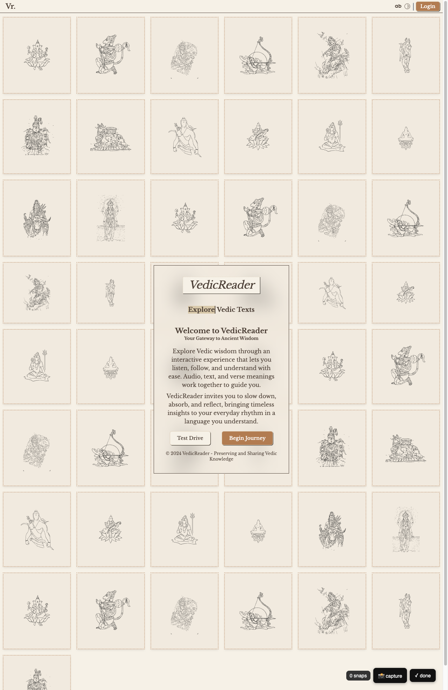

# cdp


<!-- WARNING: THIS FILE WAS AUTOGENERATED! DO NOT EDIT! -->

Some pages need a login, a click on a button or a filled form before
they show anything useful. A plain download cannot do this. This module
drives a real Chrome through the Chrome DevTools Protocol (CDP), the
interface that Chrome’s own developer tools use. It uses
[fastcdp](https://github.com/AnswerDotAI/fastcdp) for the connection.

The module uses one long-lived Chrome, which is separate from the Chrome
you browse with. This debug Chrome listens for remote control on port
9223. It has its own profile, by default in
`~/.cache/fastcdp/cdp-chrome`. A site that you log in to in the debug
Chrome stays logged in after a restart.

<table>
<colgroup>
<col style="width: 50%" />
<col style="width: 50%" />
</colgroup>
<thead>
<tr>
<th>Function</th>
<th>What it does</th>
</tr>
</thead>
<tbody>
<tr>
<td><a
href="https://vedicreader.github.io/fossick/cdp.html#cdp_setup"><code>cdp_setup</code></a></td>
<td>Starts the debug Chrome and waits until it answers.</td>
</tr>
<tr>
<td><a
href="https://vedicreader.github.io/fossick/cdp.html#cdp_connect"><code>cdp_connect</code></a></td>
<td>Connects to the debug Chrome. It starts the Chrome first when none
is running.</td>
</tr>
<tr>
<td><a
href="https://vedicreader.github.io/fossick/cdp.html#cdp_ws"><code>cdp_ws</code></a></td>
<td>Returns the websocket address of the debug Chrome. scrapling’s
browser fetchers accept it as <code>cdp_url</code>.</td>
</tr>
<tr>
<td><a
href="https://vedicreader.github.io/fossick/cdp.html#cdp_app"><code>cdp_app</code></a></td>
<td>Opens a URL in the debug Chrome as an app window, with no tabs or
address bar.</td>
</tr>
<tr>
<td><a
href="https://vedicreader.github.io/fossick/cdp.html#debug_ready"><code>debug_ready</code></a></td>
<td>Returns True when the debug Chrome is up. It never starts the
Chrome. It asks the DevTools endpoint for <code>/json/version</code>,
because Chrome opens the port a moment before it can answer there.</td>
</tr>
</tbody>
</table>

When a Chrome already listens on the port,
[`cdp_connect`](https://vedicreader.github.io/fossick/cdp.html#cdp_connect)
and [`cdp_ws`](https://vedicreader.github.io/fossick/cdp.html#cdp_ws)
use it. The `headless` and `extra_flags` arguments then have no effect.

The functions in this module are async. Call them with `await`. In
synchronous code, wrap them in
[`syncy`](https://vedicreader.github.io/fossick/core.html#syncy), as the
examples do. Most of them are methods that this module adds to the `CDP`
connection and `Page` classes of fastcdp. These `Page` methods are the
main ones:

<table>
<colgroup>
<col style="width: 50%" />
<col style="width: 50%" />
</colgroup>
<thead>
<tr>
<th>Method</th>
<th>What it does</th>
</tr>
</thead>
<tbody>
<tr>
<td><code>snapshot</code></td>
<td>Returns a short text map of the controls on the page, for an
agent.</td>
</tr>
<tr>
<td><code>fill_form</code>, <code>act</code></td>
<td>Operate those controls by their visible labels.</td>
</tr>
<tr>
<td><a
href="https://vedicreader.github.io/fossick/cli.html#calls"><code>calls</code></a></td>
<td>Records the network requests that the page makes.</td>
</tr>
<tr>
<td><code>md</code></td>
<td>Returns the live page as markdown.</td>
</tr>
</tbody>
</table>

------------------------------------------------------------------------

<a
href="https://github.com/vedicreader/fossick/blob/main/fossick/cdp.py#L71"
target="_blank" style="float:right; font-size:smaller">source</a>

### cdp_app

``` python
def cdp_app(
    url, port:int=9223, user_data_dir:NoneType=None, wait:int=15
):
```

*Open `url` as an app window, with no tabs or address bar, in the debug
Chrome.*

------------------------------------------------------------------------

<a
href="https://github.com/vedicreader/fossick/blob/main/fossick/cdp.py#L65"
target="_blank" style="float:right; font-size:smaller">source</a>

### cdp_ws

``` python
def cdp_ws(
    port:int=9223, headless:bool=True, user_data_dir:NoneType=None, extra_flags:NoneType=None
)->str:
```

*Return the websocket address of the debug Chrome on `port`, starting a
headless one if needed, for scrapling’s `cdp_url=`.*

------------------------------------------------------------------------

<a
href="https://github.com/vedicreader/fossick/blob/main/fossick/cdp.py#L58"
target="_blank" style="float:right; font-size:smaller">source</a>

### cdp_connect

``` python
async def cdp_connect(
    port:int=9223, user_data_dir:NoneType=None, headless:bool=False, extra_flags:NoneType=None
):
```

*Connect to the debug Chrome on `port`, starting it first if it is not
running.*

------------------------------------------------------------------------

<a
href="https://github.com/vedicreader/fossick/blob/main/fossick/cdp.py#L45"
target="_blank" style="float:right; font-size:smaller">source</a>

### cdp_setup

``` python
async def cdp_setup(
    port:int=9223, user_data_dir:NoneType=None, headless:bool=False, timeout:NoneType=None,
    extra_flags:NoneType=None
):
```

*Start the debug Chrome on `port` with its own profile and wait until it
accepts connections.*

------------------------------------------------------------------------

<a
href="https://github.com/vedicreader/fossick/blob/main/fossick/cdp.py#L26"
target="_blank" style="float:right; font-size:smaller">source</a>

### debug_ready

``` python
def debug_ready(
    port, host:str='127.0.0.1'
):
```

*True once the DevTools endpoint on `port` serves `/json/version`, which
an open TCP port alone does not mean.*

``` python
# debug_ready asks the endpoint, and an unused port answers nothing
with socket.socket() as s: s.bind(('127.0.0.1', 0)); free = s.getsockname()[1]
assert debug_ready(free) is False
assert _debug_ready is debug_ready   # the old private name still works
# Chrome starts with `/dev/null` as stdin, never the caller's terminal
import tempfile
from fastcore.test import test_eq
from unittest import mock
seen = []
with mock.patch('subprocess.Popen', lambda *a, **kw: seen.append(kw)), mock.patch.dict(globals(), debug_ready=lambda port: True, _chrome_flags=lambda *a: ['chrome']):
    syncy(cdp_setup(free, user_data_dir=tempfile.mkdtemp()))
test_eq([kw.get('stdin') for kw in seen], [subprocess.DEVNULL])
```

[`CDP.eval`](https://vedicreader.github.io/fossick/cdp.html#cdp.eval)
runs a JavaScript expression in the page and returns its value as Python
data. It waits for promises to resolve. It returns objects and arrays as
dictionaries and lists. It raises
[`JSError`](https://vedicreader.github.io/fossick/cdp.html#jserror) when
the JavaScript throws an error. `open_page` opens a new tab at a URL and
returns its `Page`.

------------------------------------------------------------------------

<a
href="https://github.com/vedicreader/fossick/blob/main/fossick/cdp.py#L93"
target="_blank" style="float:right; font-size:smaller">source</a>

### CDP.eval

``` python
async def eval(
    expr:str, sid:NoneType=None
):
```

*Evaluate the JavaScript `expr` in the page and return its value as
Python data.*

------------------------------------------------------------------------

<a
href="https://github.com/vedicreader/fossick/blob/main/fossick/cdp.py#L90"
target="_blank" style="float:right; font-size:smaller">source</a>

### JSError

``` python
def JSError(
    *args, **kwargs
):
```

*JavaScript raised an error while an expression was evaluated in the
page.*

------------------------------------------------------------------------

<a
href="https://github.com/vedicreader/fossick/blob/main/fossick/cdp.py#L104"
target="_blank" style="float:right; font-size:smaller">source</a>

### CDP.open_page

``` python
async def open_page(
    url
):
```

*Open a new tab at `url` and return its `Page`.*

``` python
cdp = syncy(cdp_connect())
assert cdp.is_open
```

``` python
pgs = syncy(cdp.pages)
if pgs:
    tid = pgs[0]['targetId']
    sid = syncy(cdp.attach(tid))
    pg=Page(cdp, tid, sid)
    root = syncy(pg.ax_tree())
    print(str(root)[:300])
```

    - **RootWebArea** "New Tab" `focusable=True` `url=chrome://new-tab-page/` [#1]
      - **Iframe** "" [#44]
      - **combobox** "Search Google or type a URL" `live=polite` `relevant=additions text` `focusable=True` `editable=plaintext` `settable=True` `hasPopup=listbox` [#24]
      - **button** "Search by voice

``` python
page = syncy(cdp.new_page())
syncy(page.goto('https://vedicreader.com/s/'))
rt = syncy(page.ax_tree())
print(str(rt)[:300])
```

    - **RootWebArea** "VedicReader" `focusable=True` `focused=True` `url=https://vedicreader.com/` [#2]
      - **navigation** "" [#128]
        - **link** "Vr." `focusable=True` `url=https://vedicreader.com/` [#129]
          - **heading** "Vr." `level=4` [#130]
            - **StaticText** "Vr." [#262]
              - **

``` python
syncy(page.click(rt.find_id('button', 'Test Drive')))
```

## Managing the debug Chrome

Plain HTTP requests can inspect Chrome’s DevTools endpoint.
`/json/version` describes the browser. `/json/list` lists its open tabs.
The first cell below prints both.

The second cell closes a tab, quits the browser and starts it again in a
visible window with `cdp_setup(headless=False)`. Use a visible window to
log in to a site by hand. The profile keeps the cookies, and they
survive later restarts.

``` python
# list: is a debug Chrome up, and which tabs are open in it
import httpx
port = 9223
print('running on 9223?', _debug_running(port))
ver = httpx.get(f'http://127.0.0.1:{port}/json/version').json()
print('browser:', ver['Browser'], '| ws:', ver['webSocketDebuggerUrl'])
for t in httpx.get(f'http://127.0.0.1:{port}/json/list').json():
    print(' ', t['type'], '|', t['title'][:40], '|', t['url'][:50])
print('live debug ports:', [p for p in (9222, 9223, 9224) if _debug_running(p)])
```

    running on 9223? True
    browser: Chrome/150.0.7871.129 | ws: ws://127.0.0.1:9223/devtools/browser/bb4a47a3-b032-4afd-b398-83f1de66a3ab
      page | Gayathri Dhyaanam | https://vedicreader.com/
      page | New Tab | chrome://newtab/
      iframe | chrome-untrusted://new-tab-page/one-goog | chrome-untrusted://new-tab-page/one-google-bar?par
      browser_ui | Omnibox Popup | chrome://omnibox-popup.top-chrome/
      browser_ui | Omnibox Popup | chrome://omnibox-popup.top-chrome/omnibox_popup_ai
      service_worker | Service Worker chrome-extension://ilaikd | chrome-extension://ilaikdjkclophmmhodhgfmnimfeohkg
      service_worker | Service Worker chrome-extension://hbicfl | chrome-extension://hbicflpnhfmdndpibdegbnkkpngjbhf
      service_worker | Service Worker chrome-extension://epnhoe | chrome-extension://epnhoepnmfjdbjjfanpjklemanhkjgi
    live debug ports: [9223]

``` python
# close one tab, quit the browser, then start it again in a visible window for a manual login
import httpx, time
port = 9223
tabs = httpx.get(f'http://127.0.0.1:{port}/json/list').json()
if tabs: httpx.get(f"http://127.0.0.1:{port}/json/close/{tabs[0]['id']}")
cdp = syncy(cdp_connect(port=port))
try: syncy(cdp.quit())                        # raises ConnectionClosedOK as the socket drops
except Exception: pass
time.sleep(1.5)
assert not _debug_running(port), 'browser should be down after quit()'
syncy(cdp_setup(port, headless=False))
assert _debug_running(port)
print('headed Chrome ready on', port, '— log in, then reuse it via fetch(url, session=True)')
```

    headed Chrome ready on 9223 — log in, then reuse it via fetch(url, session=True)

### App windows

[`cdp_app`](https://vedicreader.github.io/fossick/cdp.html#cdp_app)
opens a URL in the debug Chrome as an app window, without tabs or an
address bar. Use it for a local web app. It reuses the running browser
when there is one. All its windows then share the same profile and
logins. When no browser is running, it starts a visible one and waits up
to `wait` seconds.

[`cdp_app`](https://vedicreader.github.io/fossick/cdp.html#cdp_app)
returns a dictionary with these keys:

<table>
<colgroup>
<col style="width: 50%" />
<col style="width: 50%" />
</colgroup>
<thead>
<tr>
<th>Key</th>
<th>Value</th>
</tr>
</thead>
<tbody>
<tr>
<td><code>ok</code></td>
<td>True</td>
</tr>
<tr>
<td><code>url</code>, <code>port</code></td>
<td>The arguments</td>
</tr>
<tr>
<td><code>profile</code></td>
<td>The profile folder</td>
</tr>
<tr>
<td><code>reused</code></td>
<td>True when a browser was already running</td>
</tr>
<tr>
<td><code>target</code></td>
<td>The id of the new window, or None when Chrome has not listed it
within <code>wait</code> seconds (at most 5)</td>
</tr>
</tbody>
</table>

The first test below checks the launch flags without starting a browser.
The second runs
[`cdp_app`](https://vedicreader.github.io/fossick/cdp.html#cdp_app)
against stand-ins for Chrome.

``` python
# cdp_app's flags: an app window, headed, on the persistent profile. No browser is launched here.
flags = _chrome_flags(9223, _profile_dir(), False, ['--app=http://alpha.localhost:5001/'])
assert '--app=http://alpha.localhost:5001/' in flags
assert '--headless=new' not in flags                  # an app window you cannot see is useless
assert f'--user-data-dir={_profile_dir()}' in flags   # same profile as cdp_setup, so logins carry
assert str(_profile_dir()).endswith('cdp-chrome')
assert _profile_dir('~/x') == Path.home()/'x'         # user_data_dir wins, and ~ is expanded
```

``` python
# cdp_app end to end against a stubbed browser: reuse a running Chrome, report its target.
# The stubs rebind this notebook's own names, because `cdp_app` resolves them at call time.
# Patching `fossick.cdp` would leave the definitions in these cells untouched.
import httpx, subprocess as _sp

_saved = (debug_ready, _sp.Popen, httpx.get)
launched = []
class _Targets:
    def json(self): return [{'id': 'target-1', 'url': 'http://alpha.localhost:5001/'}]
try:
    debug_ready = lambda port, host='127.0.0.1': True     # a debug Chrome is already up
    _sp.Popen = lambda args, **kw: launched.append(args)
    httpx.get = lambda url, **kw: _Targets()
    r = cdp_app('http://alpha.localhost:5001/', wait=1)
finally:
    debug_ready, _sp.Popen, httpx.get = _saved

assert r['ok'] and r['reused'] is True
assert r['target'] == 'target-1'               # the window is found by its url
assert r['url'] == 'http://alpha.localhost:5001/' and r['port'] == 9223
assert '--app=http://alpha.localhost:5001/' in launched[0]
assert f'--user-data-dir={_profile_dir()}' in launched[0]
print('cdp_app:', {k: r[k] for k in ('reused', 'target')})
```

    cdp_app: {'reused': True, 'target': 'target-1'}

``` python
# Open two app windows on one browser and confirm the second reused the first's process.
a = cdp_app('https://example.com/')
b = cdp_app('https://example.org/')
assert a['ok'] and b['ok']
assert b['reused'], 'the second window should reuse the browser the first one started'
assert a['profile'] == b['profile']
print('windows:', a['target'], b['target'], '| reused:', a['reused'], b['reused'])
```

## Recording network requests

[`calls`](https://vedicreader.github.io/fossick/cli.html#calls) records
the requests that a page sends. It always opens a new tab. Given a
`url`, it loads that page in the tab and keeps listening for `tail`
seconds after the load. Without a `url`, it listens for twice `tail`
seconds.

[`calls`](https://vedicreader.github.io/fossick/cli.html#calls) returns
a dictionary keyed by request id. Each value is a request whose URL
matches `pattern`, with its id in `rid`. When Chrome still has the
response, the value also has the body under `response_body`.
[`replay_xhr`](https://vedicreader.github.io/fossick/core.html#replay_xhr)
in `fossick.core` sends a recorded request again without the browser.

------------------------------------------------------------------------

<a
href="https://github.com/vedicreader/fossick/blob/main/fossick/cdp.py#L112"
target="_blank" style="float:right; font-size:smaller">source</a>

### CDP.calls

``` python
async def calls(
    url:NoneType=None, pattern:str='.*', tail:int=3
):
```

*Record the requests matching `pattern` that a page sends, opening `url`
first when given.*

[`cdp_cookies`](https://vedicreader.github.io/fossick/cdp.html#cdp_cookies)
exports the cookies of the debug Chrome. Pass a URL or domain to get
only the cookies for that site. By default it returns a list in the
format that Playwright and scrapling accept as `cookies=`. With
`as_dict=True` it returns `{name: value}`. `fetch(url, session=True)`
calls
[`cdp_cookies`](https://vedicreader.github.io/fossick/cdp.html#cdp_cookies)
and sends the cookies with the request. This sends your logged-in
session.

------------------------------------------------------------------------

<a
href="https://github.com/vedicreader/fossick/blob/main/fossick/cdp.py#L154"
target="_blank" style="float:right; font-size:smaller">source</a>

### cdp_cookies

``` python
def cdp_cookies(
    url_or_domain:NoneType=None, port:int=9223, as_dict:bool=False
):
```

*Export the debug Chrome’s cookies, as a scrapling-ready list or as
`{name: value}` when `as_dict` is True.*

## Reading a live page

These methods read the page after its JavaScript has run. That page can
differ a lot from the HTML that the server sent. `html` returns the
current HTML. `selector` returns it as a scrapling `Selector` for CSS
and XPath queries. `md` converts it to markdown with
[`to_md`](https://vedicreader.github.io/fossick/core.html#to_md). Pass
`sel` to convert only the part that matches a CSS selector.

------------------------------------------------------------------------

<a
href="https://github.com/vedicreader/fossick/blob/main/fossick/cdp.py#L187"
target="_blank" style="float:right; font-size:smaller">source</a>

### Page.md

``` python
async def md(
    sel:str=None, **kw
):
```

*Return the current page as markdown, optionally only the part matching
the CSS selector `sel`.*

------------------------------------------------------------------------

<a
href="https://github.com/vedicreader/fossick/blob/main/fossick/cdp.py#L182"
target="_blank" style="float:right; font-size:smaller">source</a>

### Page.selector

``` python
async def selector():
```

*Return the current page as a scrapling `Selector` for CSS and XPath
queries.*

------------------------------------------------------------------------

<a
href="https://github.com/vedicreader/fossick/blob/main/fossick/cdp.py#L177"
target="_blank" style="float:right; font-size:smaller">source</a>

### Page.html

``` python
async def html():
```

*Return the page’s current HTML, after its JavaScript has run.*

## Acting on a page

An agent needs to know what it can click or type into. The HTML of a
full page is too long to read for that. `snapshot` builds a short text
view from the accessibility tree, the description of the page that
screen readers use. Each control becomes one line, `[#id] role "name"`,
such as `[#42] button "Add to cart"`. The id is the number that Chrome
gives the element. With `interactive=False`, `snapshot` also lists
headings, forms and other landmarks.

`type_text` clears a field before it types. fastcdp’s `fill_text` adds
to the text already in the field. `click_settle` clicks and then waits
for the page to settle. It does not fail when a click on a single-page
app does not navigate.

`fill_form` takes a dictionary of `{label: value}`. It finds each field
by its visible label or name. It types into text fields and chooses
options in drop-downs. When you pass `submit`, it then clicks the button
or link with that name. It returns a new snapshot. It raises
`ValueError` when no field matches a label, or when no button or link
matches `submit`.

------------------------------------------------------------------------

<a
href="https://github.com/vedicreader/fossick/blob/main/fossick/cdp.py#L232"
target="_blank" style="float:right; font-size:smaller">source</a>

### Page.fill_form

``` python
async def fill_form(
    page:fastcdp.core.Page, fields:dict, submit:str=None
):
```

*Fill form fields by visible label or name, optionally click a submit
button, and return a new snapshot.*

------------------------------------------------------------------------

<a
href="https://github.com/vedicreader/fossick/blob/main/fossick/cdp.py#L225"
target="_blank" style="float:right; font-size:smaller">source</a>

### Page.click_settle

``` python
async def click_settle(
    page:fastcdp.core.Page, backendNodeId, timeout:int=8
):
```

*Click an element and wait for the page to settle, without failing when
the click does not navigate.*

------------------------------------------------------------------------

<a
href="https://github.com/vedicreader/fossick/blob/main/fossick/cdp.py#L219"
target="_blank" style="float:right; font-size:smaller">source</a>

### Page.type_text

``` python
async def type_text(
    page:fastcdp.core.Page, backendNodeId, text
):
```

*Clear an input and type `text` into it.*

------------------------------------------------------------------------

<a
href="https://github.com/vedicreader/fossick/blob/main/fossick/cdp.py#L211"
target="_blank" style="float:right; font-size:smaller">source</a>

### Page.snapshot

``` python
async def snapshot(
    page:fastcdp.core.Page, interactive:bool=True, keep:NoneType=None
):
```

*Return a short text view of the page with one `[#id] role "name"` line
per control.*

``` python
#: `click_settle` needs `expect_navigation` (it subscribes before the click) and `click` from fastcdp 0.0.17 or later
assert all(callable(getattr(CDP, a, None)) for a in ('expect_navigation', 'click'))
```

[`ax_diff`](https://vedicreader.github.io/fossick/cdp.html#ax_diff)
compares two snapshots and lists the lines that were added or removed.
It ignores the element ids, which change on every navigation. It shows
what an action changed, or `(no change)`.

The next methods use CSS selectors. Use them when you know the markup of
the page. `node_for` returns the id of the first matching element, or
None. `click_sel` clicks an element and `fill_sel` types into it. Both
raise `ValueError` when no element matches. `eval_json` calls a
JavaScript function with Python arguments, which it converts to JSON.

------------------------------------------------------------------------

<a
href="https://github.com/vedicreader/fossick/blob/main/fossick/cdp.py#L283"
target="_blank" style="float:right; font-size:smaller">source</a>

### Page.eval_json

``` python
async def eval_json(
    page:fastcdp.core.Page, fn:str, *args
):
```

*Call the JavaScript function `fn` with `args` converted to JSON and
return its result.*

------------------------------------------------------------------------

<a
href="https://github.com/vedicreader/fossick/blob/main/fossick/cdp.py#L276"
target="_blank" style="float:right; font-size:smaller">source</a>

### Page.fill_sel

``` python
async def fill_sel(
    page:fastcdp.core.Page, sel:str, text:str
):
```

*Clear the element matching the CSS selector `sel` and type `text` into
it.*

------------------------------------------------------------------------

<a
href="https://github.com/vedicreader/fossick/blob/main/fossick/cdp.py#L269"
target="_blank" style="float:right; font-size:smaller">source</a>

### Page.click_sel

``` python
async def click_sel(
    page:fastcdp.core.Page, sel:str, wait:bool=True
):
```

*Click the element matching the CSS selector `sel`.*

------------------------------------------------------------------------

<a
href="https://github.com/vedicreader/fossick/blob/main/fossick/cdp.py#L260"
target="_blank" style="float:right; font-size:smaller">source</a>

### Page.node_for

``` python
async def node_for(
    page:fastcdp.core.Page, sel:str
):
```

*Return the id of the first element matching the CSS selector `sel`, or
None.*

------------------------------------------------------------------------

<a
href="https://github.com/vedicreader/fossick/blob/main/fossick/cdp.py#L251"
target="_blank" style="float:right; font-size:smaller">source</a>

### ax_diff

``` python
def ax_diff(
    before:str, after:str
)->str:
```

*Return the lines added or removed between two snapshots, ignoring
element ids.*

`act` runs a list of steps in order. Use it when an agent has planned a
whole flow. Each step is a tuple:

<table>
<colgroup>
<col style="width: 50%" />
<col style="width: 50%" />
</colgroup>
<thead>
<tr>
<th>Step</th>
<th>Action</th>
</tr>
</thead>
<tbody>
<tr>
<td><code>('goto', url)</code></td>
<td>Load the URL.</td>
</tr>
<tr>
<td><code>('fill', label, value)</code></td>
<td>Type the value into the field with that label.</td>
</tr>
<tr>
<td><code>('click', label)</code></td>
<td>Click the button, link or element with that name.</td>
</tr>
<tr>
<td><code>('select', label, value)</code></td>
<td>Choose an option in a drop-down.</td>
</tr>
<tr>
<td><code>('wait', text)</code></td>
<td>Wait until the text appears.</td>
</tr>
<tr>
<td><code>('wait_sel', css)</code></td>
<td>Wait until an element matches the selector.</td>
</tr>
<tr>
<td><code>('read', css)</code> or <code>('read', css, label)</code></td>
<td>Read the matching part of the page as markdown.</td>
</tr>
</tbody>
</table>

`act` returns a dictionary that holds the markdown from each
[`read`](https://vedicreader.github.io/fossick/core.html#read) step. The
key is the label, or the selector when the step has no label. An unknown
step raises `ValueError`.

------------------------------------------------------------------------

<a
href="https://github.com/vedicreader/fossick/blob/main/fossick/cdp.py#L290"
target="_blank" style="float:right; font-size:smaller">source</a>

### Page.act

``` python
async def act(
    page:fastcdp.core.Page, steps:list
):
```

*Run a list of steps on the page and return the markdown read by each
[`read`](https://vedicreader.github.io/fossick/core.html#read) step.*

## Trying it on live pages

The cells below run against the debug Chrome and real sites, so the
tests skip them. They export cookies, take a snapshot of a form, fill a
field through a CSS selector, compare snapshots across a navigation with
[`ax_diff`](https://vedicreader.github.io/fossick/cdp.html#ax_diff),
fill a form by label with `fill_form`, run the same steps through `act`,
and record a store’s search API with
[`calls`](https://vedicreader.github.io/fossick/cli.html#calls).

``` python
# cdp_ws(): websocket URL for scrapling's cdp_url= ; cdp_cookies(): export the browser's cookies
ws = cdp_ws()
assert ws.startswith('ws://'), ws
ck = cdp_cookies('https://httpbin.org', as_dict=True)
assert isinstance(ck, dict)
lst = cdp_cookies('https://httpbin.org')            # Playwright-format list for scrapling cookies=
assert isinstance(lst, list) and all(isinstance(c, dict) for c in lst)
print('ws ok |', len(ck), 'cookies')
```

    ws ok | 0 cookies

``` python
# snapshot a form, fill a field through a CSS selector, then diff snapshots across a navigation
cdp = syncy(cdp_connect())
pg  = syncy(cdp.open_page('https://httpbin.org/forms/post'))
snap = syncy(pg.snapshot())
assert snap.startswith('#') and '[#' in snap and 'textbox' in snap.lower()   # [#id] role "name" lines
bid = syncy(pg.node_for('input[name=custname]'))                             # CSS selector -> backendNodeId
assert isinstance(bid, int)
syncy(pg.fill_sel('input[name=custname]', 'Ada Lovelace'))                   # clear + type via selector
# navigate to a different page and diff the two snapshots
syncy(pg.act([('goto', 'https://example.com')]))
diff = ax_diff(snap, syncy(pg.snapshot()))
assert diff != '(no change)'
print(diff[:200])
```

    -# 
    -https://httpbin.org/forms/post
    +# Example Domain
    +https://example.com/
    -textbox "Customer name: "
    -textbox "Telephone: "
    -textbox "E-mail address: "
    -radio " Small"
    -radio " Medium"
    -radio " Larg

``` python
# fill a real form by label with fill_form
cdp = syncy(cdp_connect())
fp  = syncy(cdp.open_page('https://httpbin.org/forms/post'))
snap = syncy(fp.fill_form({'Customer name': 'Ada Lovelace'}))   # returns a snapshot
assert '[#' in snap
```

``` python
# declarative equivalent: navigate, fill, and read a region back as markdown
reads = syncy(fp.act([('goto', 'https://httpbin.org/forms/post'),
                      ('fill', 'Customer name', 'Ada Lovelace'),
                      ('read', 'form', 'form')]))
assert 'form' in reads and isinstance(reads['form'], str)
print(list(reads))
```

    ['form']

``` python
apis = syncy(cdp.calls('https://www.woolworths.com.au/shop/search/products?searchTerm=Apples%20%26%20Pears', pattern='.apis/ui/Search/products'))
```

## Screenshots and annotation

[`collect`](https://vedicreader.github.io/fossick/cli.html#collect)
gathers screenshots while a person browses. It adds a small bar with a
capture button and a done button to the page. Each press of capture
takes a screenshot with the bar hidden.

[`collect`](https://vedicreader.github.io/fossick/cli.html#collect)
stops when one of these happens:

- The person presses done.
- `count` screenshots have been taken.
- `tout` seconds have passed.
- The `stop` event is set.

With `every_n`,
[`collect`](https://vedicreader.github.io/fossick/cli.html#collect) also
takes a screenshot every `every_n` seconds without a button press. When
you pass `save_dir`,
[`collect`](https://vedicreader.github.io/fossick/cli.html#collect)
saves each screenshot there as a PNG file named from `prefix` (by
default the page title) and returns a list of `(image, path)` pairs.
Without `save_dir` it returns a list of images.

`BUTTON_JS`, `HIDE` and `SHOW` are the scripts that draw, hide and show
the bar.

------------------------------------------------------------------------

<a
href="https://github.com/vedicreader/fossick/blob/main/fossick/cdp.py#L345"
target="_blank" style="float:right; font-size:smaller">source</a>

### Page.collect

``` python
async def collect(
    page:fastcdp.core.Page, save_dir:NoneType=None, prefix:NoneType=None, stop:NoneType=None, tout:NoneType=None,
    count:NoneType=None, every_n:NoneType=None
):
```

*Take screenshots each time the person presses the injected capture
button, or on a timer, and return them.*

``` python
page = syncy(cdp.new_page())
syncy(page.goto('https://vedicreader.com/s/'))
imgs = syncy(page.collect(count=1, tout=5, every_n=1))
if imgs: imgs[0].width, imgs[0].height = 200, 400
imgs[0]
```

    📸 capture, ✓ done (or stop.set()) to finish. → None/



[`annotate`](https://vedicreader.github.io/fossick/cli.html#annotate)
lets a person point at parts of a page. The page outlines and numbers
each element that the person clicks. An agent can use this to ask a
person which button or field they mean.

[`annotate`](https://vedicreader.github.io/fossick/cli.html#annotate)
ends when the person presses done, when `tout` seconds have passed or
when the `stop` event is set. It then takes a screenshot with the
numbers on it. It returns `(img, selected)`. `selected` is a list with
one dictionary per element, with the keys `n`, `role`, `name` and
`selector` (a CSS selector). With `save_dir`,
[`annotate`](https://vedicreader.github.io/fossick/cli.html#annotate)
also saves the screenshot there as a PNG file named from `prefix`.

The scripts that
[`annotate`](https://vedicreader.github.io/fossick/cli.html#annotate)
injects are `ANNOTATE_JS`, `ANNOTATE_BAR_JS` and `ANNOTATE_CLEANUP_JS`.

------------------------------------------------------------------------

<a
href="https://github.com/vedicreader/fossick/blob/main/fossick/cdp.py#L472"
target="_blank" style="float:right; font-size:smaller">source</a>

### Page.annotate

``` python
async def annotate(
    page:fastcdp.core.Page, save_dir:NoneType=None, prefix:NoneType=None, stop:NoneType=None, tout:NoneType=None
):
```

*Let a person click elements to number them and return a screenshot with
the numbers and a list of the chosen elements.*

``` python
img, elements = syncy(page.annotate(save_dir='shots', tout=2))
img.height, img.width = 400, 200
img
```

    Click elements to annotate, ✓ Done when ready.
    saved VedicReader.png


``` python
from fastcore.nbio import read_nb
```

``` python
# CI has no debug Chrome, so a cell that connects to one must be `eval: false` or nbdev-test times out on it.
_live = [i for i,c in enumerate(read_nb('01_cdp.ipynb').cells) if c.cell_type=='code' and 'syncy(cdp_connect())' in c.source
         and not c.source.startswith('#| export') and '#| eval: false' not in c.source]
assert not _live, _live
```
