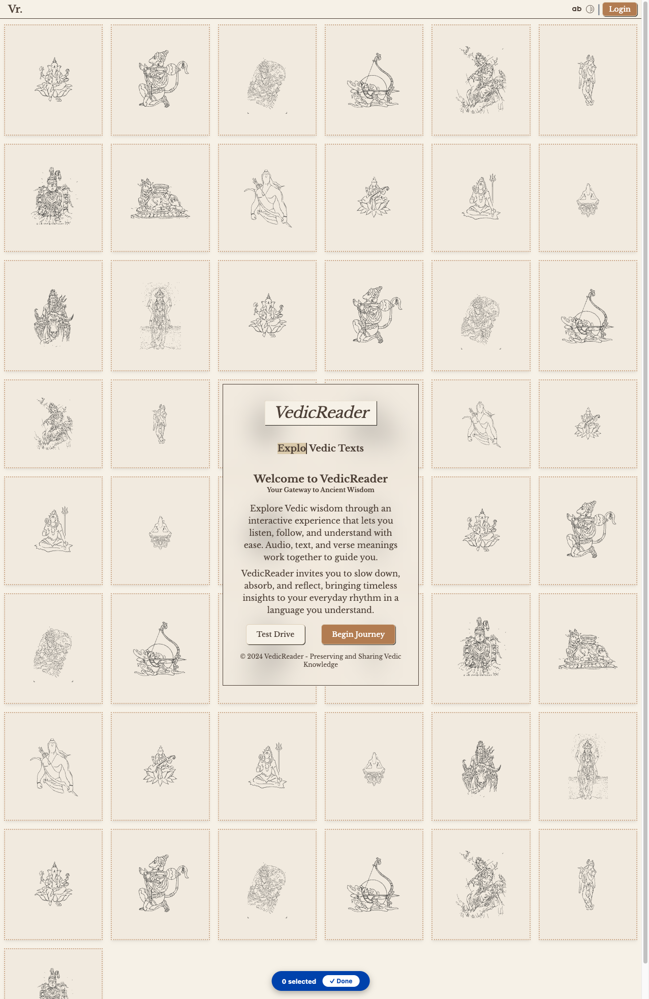

# cdp


<!-- WARNING: THIS FILE WAS AUTOGENERATED! DO NOT EDIT! -->

Some web work cannot be done with downloads alone. A page may need a
login, a click on a button, or a form filled in before it shows anything
useful. This module drives a real Chrome through the Chrome DevTools
Protocol (CDP), the interface Chrome’s own developer tools use, by way
of [fastcdp](https://github.com/AnswerDotAI/fastcdp).

It uses one long-lived Chrome, separate from the one you browse with. It
listens for remote control on port 9223 and keeps its own profile, by
default in `~/.cache/fastcdp/cdp-chrome`, so anything you log in to
there stays logged in across restarts.
[`cdp_connect`](https://vedicreader.github.io/fossick/cdp.html#cdp_connect)
attaches to that Chrome and starts it first if it is not running;
[`cdp_setup`](https://vedicreader.github.io/fossick/cdp.html#cdp_setup)
only starts it.
[`cdp_ws`](https://vedicreader.github.io/fossick/cdp.html#cdp_ws)
returns its websocket address, which scrapling’s browser fetchers accept
as `cdp_url`, and
[`cdp_app`](https://vedicreader.github.io/fossick/cdp.html#cdp_app)
opens a URL in it as an app window with no tabs or address bar.
[`debug_ready`](https://vedicreader.github.io/fossick/cdp.html#debug_ready)
tells you whether that Chrome is up without starting it: it asks the
DevTools endpoint for `/json/version`, because Chrome opens the port a
moment before it can answer there.

The functions here are async, so call them with `await`, or wrap them in
[`syncy`](https://vedicreader.github.io/fossick/core.html#syncy) from
synchronous code as the examples do. Most of them are methods added to
fastcdp’s `CDP` connection and `Page` classes. On a page, `snapshot`
gives an agent a short text map of the controls it can use, `fill_form`
and `act` operate those controls by their visible labels,
[`calls`](https://vedicreader.github.io/fossick/cli.html#calls) records
the network requests the page makes, and `md` returns the live page as
markdown.

------------------------------------------------------------------------

<a
href="https://github.com/vedicreader/fossick/blob/main/fossick/cdp.py#L71"
target="_blank" style="float:right; font-size:smaller">source</a>

### cdp_app

``` python
def cdp_app(
    url, port:int=9223, user_data_dir:NoneType=None, wait:int=15
):
```

*Open `url` as an app window, with no tabs or address bar, in the debug
Chrome.*

------------------------------------------------------------------------

<a
href="https://github.com/vedicreader/fossick/blob/main/fossick/cdp.py#L65"
target="_blank" style="float:right; font-size:smaller">source</a>

### cdp_ws

``` python
def cdp_ws(
    port:int=9223, headless:bool=True, user_data_dir:NoneType=None, extra_flags:NoneType=None
)->str:
```

*Return the websocket address of the debug Chrome on `port`, starting a
headless one if needed, for scrapling’s `cdp_url=`.*

------------------------------------------------------------------------

<a
href="https://github.com/vedicreader/fossick/blob/main/fossick/cdp.py#L58"
target="_blank" style="float:right; font-size:smaller">source</a>

### cdp_connect

``` python
async def cdp_connect(
    port:int=9223, user_data_dir:NoneType=None, headless:bool=False, extra_flags:NoneType=None
):
```

*Connect to the debug Chrome on `port`, starting it first if it is not
running.*

------------------------------------------------------------------------

<a
href="https://github.com/vedicreader/fossick/blob/main/fossick/cdp.py#L45"
target="_blank" style="float:right; font-size:smaller">source</a>

### cdp_setup

``` python
async def cdp_setup(
    port:int=9223, user_data_dir:NoneType=None, headless:bool=False, timeout:NoneType=None,
    extra_flags:NoneType=None
):
```

*Start the debug Chrome on `port` with its own profile and wait until it
accepts connections.*

------------------------------------------------------------------------

<a
href="https://github.com/vedicreader/fossick/blob/main/fossick/cdp.py#L26"
target="_blank" style="float:right; font-size:smaller">source</a>

### debug_ready

``` python
def debug_ready(
    port, host:str='127.0.0.1'
):
```

*True once the DevTools endpoint on `port` serves `/json/version`, which
an open TCP port alone does not mean.*

``` python
# debug_ready asks the endpoint, and an unused port answers nothing
with socket.socket() as s: s.bind(('127.0.0.1', 0)); free = s.getsockname()[1]
assert debug_ready(free) is False
assert _debug_ready is debug_ready   # the old private name still works
# Chrome starts with `/dev/null` as stdin, never the caller's terminal
import tempfile
from fastcore.test import test_eq
from unittest import mock
seen = []
with mock.patch('subprocess.Popen', lambda *a, **kw: seen.append(kw)), mock.patch.dict(globals(), debug_ready=lambda port: True, _chrome_flags=lambda *a: ['chrome']):
    syncy(cdp_setup(free, user_data_dir=tempfile.mkdtemp()))
test_eq([kw.get('stdin') for kw in seen], [subprocess.DEVNULL])
```

[`CDP.eval`](https://vedicreader.github.io/fossick/cdp.html#cdp.eval)
runs a JavaScript expression in the page and returns its value as Python
data. It waits for promises to resolve, returns objects and arrays as
dictionaries and lists, and raises
[`JSError`](https://vedicreader.github.io/fossick/cdp.html#jserror) when
the JavaScript throws, so a script error is never mistaken for an empty
result. `open_page` opens a new tab at a URL and returns its `Page`.

------------------------------------------------------------------------

<a
href="https://github.com/vedicreader/fossick/blob/main/fossick/cdp.py#L93"
target="_blank" style="float:right; font-size:smaller">source</a>

### CDP.eval

``` python
async def eval(
    expr:str, sid:NoneType=None
):
```

*Evaluate the JavaScript `expr` in the page and return its value as
Python data.*

------------------------------------------------------------------------

<a
href="https://github.com/vedicreader/fossick/blob/main/fossick/cdp.py#L90"
target="_blank" style="float:right; font-size:smaller">source</a>

### JSError

``` python
def JSError(
    *args, **kwargs
):
```

*JavaScript raised an error while an expression was evaluated in the
page.*

------------------------------------------------------------------------

<a
href="https://github.com/vedicreader/fossick/blob/main/fossick/cdp.py#L104"
target="_blank" style="float:right; font-size:smaller">source</a>

### CDP.open_page

``` python
async def open_page(
    url
):
```

*Open a new tab at `url` and return its `Page`.*

``` python
cdp = syncy(cdp_connect())
assert cdp.is_open
```

``` python
pgs = syncy(cdp.pages)
if pgs:
    tid = pgs[0]['targetId']
    sid = syncy(cdp.attach(tid))
    pg=Page(cdp, tid, sid)
    root = syncy(pg.ax_tree())
    print(str(root)[:300])
```

    - **RootWebArea** "New Tab" `focusable=True` `url=chrome://new-tab-page/` [#1]
      - **Iframe** "" [#44]
      - **combobox** "Search Google or type a URL" `live=polite` `relevant=additions text` `focusable=True` `editable=plaintext` `settable=True` `hasPopup=listbox` [#24]
      - **button** "Search by voice

``` python
page = syncy(cdp.new_page())
syncy(page.goto('https://vedicreader.com/s/'))
rt = syncy(page.ax_tree())
print(str(rt)[:300])
```

    - **RootWebArea** "VedicReader" `focusable=True` `focused=True` `url=https://vedicreader.com/` [#2]
      - **navigation** "" [#128]
        - **link** "Vr." `focusable=True` `url=https://vedicreader.com/` [#129]
          - **heading** "Vr." `level=4` [#130]
            - **StaticText** "Vr." [#262]
              - **

``` python
syncy(page.click(rt.find_id('button', 'Test Drive')))
```

## Managing the debug Chrome

Chrome’s DevTools endpoint can be inspected with plain HTTP.
`/json/version` describes the browser and `/json/list` lists its open
tabs. The first cell below lists them. The second closes a tab, quits
the browser, and starts it again in a visible window with
`cdp_setup(headless=False)`, which is how you log in to a site by hand.
The cookies are saved in the profile, so they survive later restarts.

``` python
# LIST — is a debug Chrome up, and what's open in it?
import httpx
port = 9223
print('running on 9223?', _debug_running(port))
ver = httpx.get(f'http://127.0.0.1:{port}/json/version').json()
print('browser:', ver['Browser'], '| ws:', ver['webSocketDebuggerUrl'])
for t in httpx.get(f'http://127.0.0.1:{port}/json/list').json():   # open tabs/pages
    print(' ', t['type'], '|', t['title'][:40], '|', t['url'][:50])
print('live debug ports:', [p for p in (9222, 9223, 9224) if _debug_running(p)])
```

    running on 9223? True
    browser: Chrome/150.0.7871.129 | ws: ws://127.0.0.1:9223/devtools/browser/bb4a47a3-b032-4afd-b398-83f1de66a3ab
      page | Gayathri Dhyaanam | https://vedicreader.com/
      page | New Tab | chrome://newtab/
      iframe | chrome-untrusted://new-tab-page/one-goog | chrome-untrusted://new-tab-page/one-google-bar?par
      browser_ui | Omnibox Popup | chrome://omnibox-popup.top-chrome/
      browser_ui | Omnibox Popup | chrome://omnibox-popup.top-chrome/omnibox_popup_ai
      service_worker | Service Worker chrome-extension://ilaikd | chrome-extension://ilaikdjkclophmmhodhgfmnimfeohkg
      service_worker | Service Worker chrome-extension://hbicfl | chrome-extension://hbicflpnhfmdndpibdegbnkkpngjbhf
      service_worker | Service Worker chrome-extension://epnhoe | chrome-extension://epnhoepnmfjdbjjfanpjklemanhkjgi
    live debug ports: [9223]

``` python
# CLOSE a single tab, QUIT the whole browser, then RELAUNCH it HEADED for interactive login
import httpx, time
port = 9223
tabs = httpx.get(f'http://127.0.0.1:{port}/json/list').json()
if tabs: httpx.get(f"http://127.0.0.1:{port}/json/close/{tabs[0]['id']}")   # close one tab by target id
cdp = syncy(cdp_connect(port=port))
try: syncy(cdp.quit())                        # quit browser+connection; raises ConnectionClosedOK as the socket drops
except Exception: pass
time.sleep(1.5)
assert not _debug_running(port), 'browser should be down after quit()'
syncy(cdp_setup(port, headless=False))        # relaunch HEADED so you can log in by hand
assert _debug_running(port)
print('headed Chrome ready on', port, '— log in, then reuse it via fetch(url, session=True)')
```

    headed Chrome ready on 9223 — log in, then reuse it via fetch(url, session=True)

### App windows

[`cdp_app`](https://vedicreader.github.io/fossick/cdp.html#cdp_app)
opens a URL in the debug Chrome as an app window, without tabs or an
address bar, which suits a local web app. It reuses the running browser
when there is one, so all its windows share the same profile and logins.
It returns `ok`, the `url`, the `port`, the `profile` folder, `reused`
(whether a browser was already running) and `target`, the id of the new
window once Chrome reports it. The first test checks the launch flags
without starting a browser and the second runs
[`cdp_app`](https://vedicreader.github.io/fossick/cdp.html#cdp_app)
against stand-ins for Chrome.

``` python
# cdp_app's flags: an app window, headed, on the persistent profile. No browser is launched here.
flags = _chrome_flags(9223, _profile_dir(), False, ['--app=http://alpha.localhost:5001/'])
assert '--app=http://alpha.localhost:5001/' in flags
assert '--headless=new' not in flags                  # an app window you cannot see is useless
assert f'--user-data-dir={_profile_dir()}' in flags   # same profile as cdp_setup, so logins carry
assert str(_profile_dir()).endswith('cdp-chrome')
assert _profile_dir('~/x') == Path.home()/'x'         # user_data_dir wins, and ~ is expanded
```

``` python
# cdp_app end to end against a stubbed browser: reuse a running Chrome, report its target.
# The stubs rebind this notebook's own names, because that is what `cdp_app` resolves at call
# time -- patching `fossick.cdp` would leave the definitions in these cells untouched.
import httpx, subprocess as _sp

_saved = (debug_ready, _sp.Popen, httpx.get)
launched = []
class _Targets:
    def json(self): return [{'id': 'target-1', 'url': 'http://alpha.localhost:5001/'}]
try:
    debug_ready = lambda port, host='127.0.0.1': True     # a debug Chrome is already up
    _sp.Popen = lambda args, **kw: launched.append(args)
    httpx.get = lambda url, **kw: _Targets()
    r = cdp_app('http://alpha.localhost:5001/', wait=1)
finally:
    debug_ready, _sp.Popen, httpx.get = _saved

assert r['ok'] and r['reused'] is True         # reused, so no second resident browser
assert r['target'] == 'target-1'               # and the window was found by its url
assert r['url'] == 'http://alpha.localhost:5001/' and r['port'] == 9223
assert '--app=http://alpha.localhost:5001/' in launched[0]
assert f'--user-data-dir={_profile_dir()}' in launched[0]
print('cdp_app:', {k: r[k] for k in ('reused', 'target')})
```

    cdp_app: {'reused': True, 'target': 'target-1'}

``` python
# Open two app windows on one browser and confirm the second reused the first's process.
a = cdp_app('https://example.com/')
b = cdp_app('https://example.org/')
assert a['ok'] and b['ok']
assert b['reused'], 'the second window should reuse the browser the first one started'
assert a['profile'] == b['profile']
print('windows:', a['target'], b['target'], '| reused:', a['reused'], b['reused'])
```

## Recording network requests

[`calls`](https://vedicreader.github.io/fossick/cli.html#calls) records
the requests a page sends while it loads. Given a `url`, it opens that
page in a new tab and listens until `tail` seconds after it loads.
Without one it only listens, for twice `tail` seconds. It returns a
dictionary keyed by request id, holding each request whose URL matches
`pattern` and, where Chrome still has it, the response body under
`response_body`.
[`replay_xhr`](https://vedicreader.github.io/fossick/core.html#replay_xhr)
in `fossick.core` can then send any of them again without the browser.

------------------------------------------------------------------------

<a
href="https://github.com/vedicreader/fossick/blob/main/fossick/cdp.py#L112"
target="_blank" style="float:right; font-size:smaller">source</a>

### CDP.calls

``` python
async def calls(
    url:NoneType=None, pattern:str='.*', tail:int=3
):
```

*Record the requests matching `pattern` that a page sends, opening `url`
first when given.*

[`cdp_cookies`](https://vedicreader.github.io/fossick/cdp.html#cdp_cookies)
exports the debug Chrome’s cookies, optionally only those for one site.
By default it returns them in the list format Playwright and scrapling
accept as `cookies=`; with `as_dict=True` it returns `{name: value}`.
`fetch(url, session=True)` uses it to send your logged-in cookies with a
request.

------------------------------------------------------------------------

<a
href="https://github.com/vedicreader/fossick/blob/main/fossick/cdp.py#L149"
target="_blank" style="float:right; font-size:smaller">source</a>

### cdp_cookies

``` python
def cdp_cookies(
    url_or_domain:NoneType=None, port:int=9223, as_dict:bool=False
):
```

*Export the debug Chrome’s cookies, as a scrapling-ready list or as
`{name: value}` when `as_dict` is True.*

## Reading a live page

These read the page as it stands after its JavaScript has run, which can
differ a lot from the HTML the server sent. `html` returns the current
HTML, `selector` wraps it in a scrapling `Selector` for CSS and XPath
queries, and `md` converts it to markdown with
[`to_md`](https://vedicreader.github.io/fossick/core.html#to_md),
optionally only the part matching `sel`.

------------------------------------------------------------------------

<a
href="https://github.com/vedicreader/fossick/blob/main/fossick/cdp.py#L181"
target="_blank" style="float:right; font-size:smaller">source</a>

### Page.md

``` python
async def md(
    sel:str=None, **kw
):
```

*Return the current page as markdown, optionally only the part matching
the CSS selector `sel`.*

------------------------------------------------------------------------

<a
href="https://github.com/vedicreader/fossick/blob/main/fossick/cdp.py#L176"
target="_blank" style="float:right; font-size:smaller">source</a>

### Page.selector

``` python
async def selector():
```

*Return the current page as a scrapling `Selector` for CSS and XPath
queries.*

------------------------------------------------------------------------

<a
href="https://github.com/vedicreader/fossick/blob/main/fossick/cdp.py#L171"
target="_blank" style="float:right; font-size:smaller">source</a>

### Page.html

``` python
async def html():
```

*Return the page’s current HTML, after its JavaScript has run.*

## Acting on a page

An agent needs to know what it can click or type into, and a full page
of HTML is far too long to read for that. `snapshot` builds a short text
view from the accessibility tree, the description of the page that
screen readers use. Each control becomes one line, `[#id] role "name"`,
such as `[#42] button "Add to cart"`, where the id is Chrome’s number
for that element. With `interactive=False` it also lists headings, forms
and other landmarks.

The other methods act on the page. `type_text` clears a field before
typing, unlike fastcdp’s `fill_text`, which adds to what is already
there. `click_settle` clicks and then waits for the page to settle,
without failing when a click on a single-page app does not navigate.
`fill_form` fills fields by their visible label or name, given as
`{label: value}`, chooses options in drop-downs, optionally clicks a
submit button by its name, and returns a fresh snapshot.

------------------------------------------------------------------------

<a
href="https://github.com/vedicreader/fossick/blob/main/fossick/cdp.py#L226"
target="_blank" style="float:right; font-size:smaller">source</a>

### Page.fill_form

``` python
async def fill_form(
    page:fastcdp.core.Page, fields:dict, submit:str=None
):
```

*Fill form fields by visible label or name, optionally click a submit
button, and return a new snapshot.*

------------------------------------------------------------------------

<a
href="https://github.com/vedicreader/fossick/blob/main/fossick/cdp.py#L219"
target="_blank" style="float:right; font-size:smaller">source</a>

### Page.click_settle

``` python
async def click_settle(
    page:fastcdp.core.Page, backendNodeId, timeout:int=8
):
```

*Click an element and wait for the page to settle, without failing when
the click does not navigate.*

------------------------------------------------------------------------

<a
href="https://github.com/vedicreader/fossick/blob/main/fossick/cdp.py#L213"
target="_blank" style="float:right; font-size:smaller">source</a>

### Page.type_text

``` python
async def type_text(
    page:fastcdp.core.Page, backendNodeId, text
):
```

*Clear an input and type `text` into it.*

------------------------------------------------------------------------

<a
href="https://github.com/vedicreader/fossick/blob/main/fossick/cdp.py#L205"
target="_blank" style="float:right; font-size:smaller">source</a>

### Page.snapshot

``` python
async def snapshot(
    page:fastcdp.core.Page, interactive:bool=True, keep:NoneType=None
):
```

*Return a short text view of the page with one `[#id] role "name"` line
per control.*

[`ax_diff`](https://vedicreader.github.io/fossick/cdp.html#ax_diff)
compares two snapshots and lists the lines that were added or removed,
ignoring the element ids, which change on every navigation. It shows
what an action changed. The next methods work with CSS selectors for
when you know the page’s markup: `node_for` finds an element’s id, and
`click_sel` and `fill_sel` click it or type into it. `eval_json` calls a
JavaScript function with Python arguments, converted to JSON.

------------------------------------------------------------------------

<a
href="https://github.com/vedicreader/fossick/blob/main/fossick/cdp.py#L277"
target="_blank" style="float:right; font-size:smaller">source</a>

### Page.eval_json

``` python
async def eval_json(
    page:fastcdp.core.Page, fn:str, *args
):
```

*Call the JavaScript function `fn` with `args` converted to JSON and
return its result.*

------------------------------------------------------------------------

<a
href="https://github.com/vedicreader/fossick/blob/main/fossick/cdp.py#L270"
target="_blank" style="float:right; font-size:smaller">source</a>

### Page.fill_sel

``` python
async def fill_sel(
    page:fastcdp.core.Page, sel:str, text:str
):
```

*Clear the element matching the CSS selector `sel` and type `text` into
it.*

------------------------------------------------------------------------

<a
href="https://github.com/vedicreader/fossick/blob/main/fossick/cdp.py#L263"
target="_blank" style="float:right; font-size:smaller">source</a>

### Page.click_sel

``` python
async def click_sel(
    page:fastcdp.core.Page, sel:str, wait:bool=True
):
```

*Click the element matching the CSS selector `sel`.*

------------------------------------------------------------------------

<a
href="https://github.com/vedicreader/fossick/blob/main/fossick/cdp.py#L254"
target="_blank" style="float:right; font-size:smaller">source</a>

### Page.node_for

``` python
async def node_for(
    page:fastcdp.core.Page, sel:str
):
```

*Return the id of the first element matching the CSS selector `sel`, or
None.*

------------------------------------------------------------------------

<a
href="https://github.com/vedicreader/fossick/blob/main/fossick/cdp.py#L245"
target="_blank" style="float:right; font-size:smaller">source</a>

### ax_diff

``` python
def ax_diff(
    before:str, after:str
)->str:
```

*Return the lines added or removed between two snapshots, ignoring
element ids.*

`act` runs a list of steps in order, which is useful when an agent has
planned a whole flow. Each step is a tuple: `('goto', url)`,
`('fill', label, value)`, `('click', label)`,
`('select', label, value)`, `('wait', text)`, `('wait_sel', css)` or
`('read', css)`, which can take a label as a third item. It returns a
dictionary with the markdown read by each
[`read`](https://vedicreader.github.io/fossick/core.html#read) step,
keyed by its label or selector. An unknown step raises `ValueError`.

------------------------------------------------------------------------

<a
href="https://github.com/vedicreader/fossick/blob/main/fossick/cdp.py#L284"
target="_blank" style="float:right; font-size:smaller">source</a>

### Page.act

``` python
async def act(
    page:fastcdp.core.Page, steps:list
):
```

*Run a list of steps on the page and return the markdown read by each
[`read`](https://vedicreader.github.io/fossick/core.html#read) step.*

## Trying it on live pages

The cells below run against the debug Chrome and real sites, so the
tests skip them. They export cookies, take a snapshot of a form, fill a
field through a CSS selector, compare snapshots across a navigation with
[`ax_diff`](https://vedicreader.github.io/fossick/cdp.html#ax_diff),
fill a form by label with `fill_form`, run the same steps through `act`,
and record a store’s search API with
[`calls`](https://vedicreader.github.io/fossick/cli.html#calls).

``` python
# cdp_ws(): websocket URL for scrapling's cdp_url= ; cdp_cookies(): export the browser's cookies
ws = cdp_ws()
assert ws.startswith('ws://'), ws
ck = cdp_cookies('https://httpbin.org', as_dict=True)
assert isinstance(ck, dict)
lst = cdp_cookies('https://httpbin.org')            # Playwright-format list for scrapling cookies=
assert isinstance(lst, list) and all(isinstance(c, dict) for c in lst)
print('ws ok |', len(ck), 'cookies')
```

    ws ok | 0 cookies

``` python
# Live in the debug Chrome: snapshot() -> CSS->CDP bridge -> ax_diff() across a navigation
cdp = syncy(cdp_connect())
pg  = syncy(cdp.open_page('https://httpbin.org/forms/post'))
snap = syncy(pg.snapshot())
assert snap.startswith('#') and '[#' in snap and 'textbox' in snap.lower()   # [#id] role "name" lines
bid = syncy(pg.node_for('input[name=custname]'))                             # CSS selector -> backendNodeId
assert isinstance(bid, int)
syncy(pg.fill_sel('input[name=custname]', 'Ada Lovelace'))                   # clear + type via selector
# ax_diff() surfaces STRUCTURAL change: navigate to a different page and diff the two snapshots
syncy(pg.act([('goto', 'https://example.com')]))
diff = ax_diff(snap, syncy(pg.snapshot()))
assert diff != '(no change)'                                                 # different page -> non-empty diff
print(diff[:200])
```

    -# 
    -https://httpbin.org/forms/post
    +# Example Domain
    +https://example.com/
    -textbox "Customer name: "
    -textbox "Telephone: "
    -textbox "E-mail address: "
    -radio " Small"
    -radio " Medium"
    -radio " Larg

``` python
# fill_form()/act(): fill a real form by label, then read back the echoed values
cdp = syncy(cdp_connect())
fp  = syncy(cdp.open_page('https://httpbin.org/forms/post'))
snap = syncy(fp.fill_form({'Customer name': 'Ada Lovelace'}))   # fill by label -> returns a snapshot()
assert '[#' in snap
```

``` python
# declarative equivalent: navigate, fill, and read a region back as markdown
reads = syncy(fp.act([('goto', 'https://httpbin.org/forms/post'),
                      ('fill', 'Customer name', 'Ada Lovelace'),
                      ('read', 'form', 'form')]))
assert 'form' in reads and isinstance(reads['form'], str)
print(list(reads))
```

    ['form']

``` python
apis = syncy(cdp.calls('https://www.woolworths.com.au/shop/search/products?searchTerm=Apples%20%26%20Pears', pattern='.apis/ui/Search/products'))
```

## Screenshots and annotation

[`collect`](https://vedicreader.github.io/fossick/cli.html#collect)
gathers screenshots while a person browses. It adds a small bar with a
capture button and a done button to the page. Each press of capture
saves a screenshot, with the bar hidden. It stops when done is pressed,
when `count` screenshots have been taken, or after `tout` seconds, and
with `every_n` it also takes one every `every_n` seconds by itself.
Screenshots are saved as PNG files in `save_dir` when one is given, and
returned. `BUTTON_JS`, `HIDE` and `SHOW` are the scripts that draw, hide
and show the bar.

------------------------------------------------------------------------

<a
href="https://github.com/vedicreader/fossick/blob/main/fossick/cdp.py#L339"
target="_blank" style="float:right; font-size:smaller">source</a>

### Page.collect

``` python
async def collect(
    page:fastcdp.core.Page, save_dir:NoneType=None, prefix:NoneType=None, stop:NoneType=None, tout:NoneType=None,
    count:NoneType=None, every_n:NoneType=None
):
```

*Take screenshots each time the person presses the injected capture
button, or on a timer, and return them.*

``` python
page = syncy(cdp.new_page())
syncy(page.goto('https://vedicreader.com/s/'))
imgs = syncy(page.collect(count=1, tout=5, every_n=1))
if imgs: imgs[0].width, imgs[0].height = 200, 400
imgs[0]
```

    📸 capture, ✓ done (or stop.set()) to finish. → None/


[`annotate`](https://vedicreader.github.io/fossick/cli.html#annotate)
lets a person point at parts of a page. Each element they click is
outlined and numbered, and when they press done it returns a screenshot
with the numbers on it and a list with each element’s number,
accessibility role, name and a CSS selector for it. An agent can use
this to ask a person which button or field they mean. The scripts it
injects are `ANNOTATE_JS`, `ANNOTATE_BAR_JS` and `ANNOTATE_CLEANUP_JS`.

------------------------------------------------------------------------

<a
href="https://github.com/vedicreader/fossick/blob/main/fossick/cdp.py#L466"
target="_blank" style="float:right; font-size:smaller">source</a>

### Page.annotate

``` python
async def annotate(
    page:fastcdp.core.Page, save_dir:NoneType=None, prefix:NoneType=None, stop:NoneType=None, tout:NoneType=None
):
```

*Let a person click elements to number them and return a screenshot with
the numbers and a list of the chosen elements.*

``` python
img, elements = syncy(page.annotate(save_dir='shots', tout=2))
img.height, img.width = 400, 200
img
```

    Click elements to annotate, ✓ Done when ready.
    saved VedicReader.png



``` python
from fastcore.nbio import read_nb
```

``` python
# CI has no debug Chrome, so a cell that connects to one must be `eval: false` or nbdev-test times out on it.
_live = [i for i,c in enumerate(read_nb('01_cdp.ipynb').cells) if c.cell_type=='code' and 'syncy(cdp_connect())' in c.source
         and not c.source.startswith('#| export') and '#| eval: false' not in c.source]
assert not _live, _live
```
